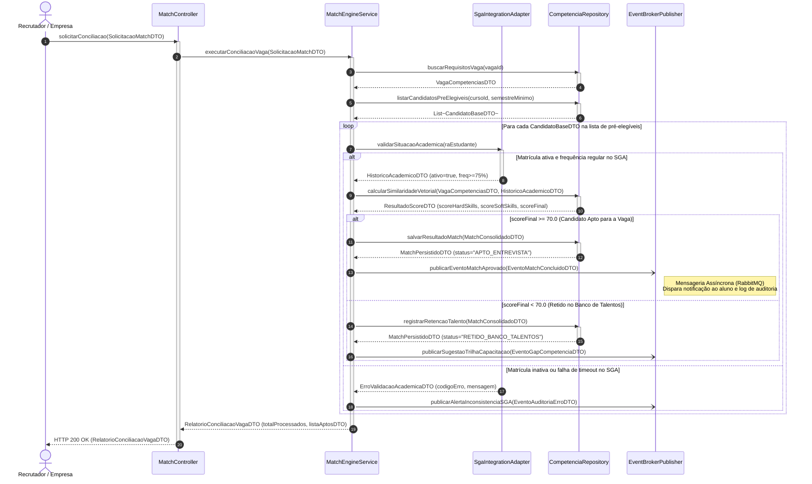
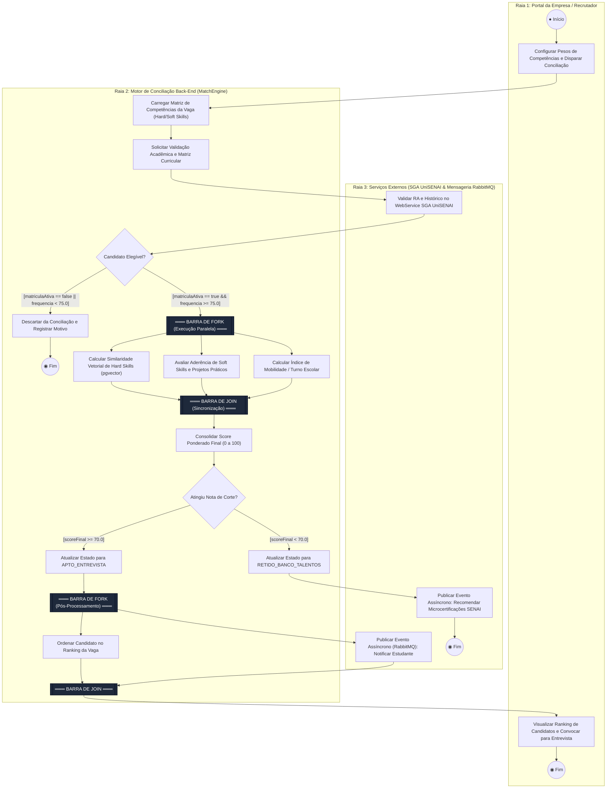
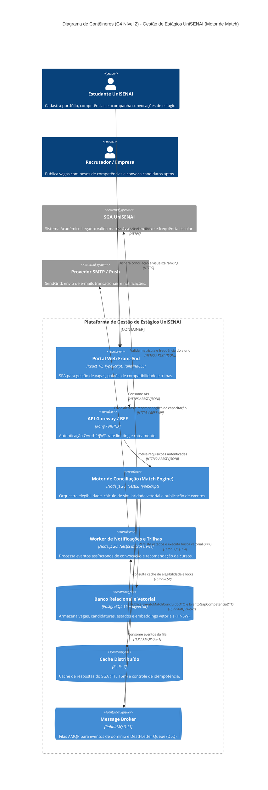

# Dossiê de Arquitetura Viva e Modelagem Comportamental as-Code
**Projeto:** Plataforma de Gestão de Estágios UniSENAI  
**Funcionalidade Crítica:** Algoritmo de Conciliação (*Match*) de Competências  
**Autor:** Eduardo Luciano Paes  

---

## 1. Contextualização da Funcionalidade Crítica
O **Algoritmo de Conciliação (Match) de Competências** é o núcleo decisório da Plataforma de Gestão de Estágios do UniSENAI. Sua responsabilidade é cruzar, de forma auditável e semântica, a matriz de requisitos técnicos (*Hard Skills*) e comportamentais (*Soft Skills*) exigidos por uma vaga de estágio com o histórico acadêmico oficial (validado junto ao SGA UniSENAI) e o portfólio prático dos estudantes.

Para evitar a **Deriva Arquitetural (*Architectural Drift*)**, toda a especificação comportamental e estrutural deste módulo é mantida sob o paradigma *Diagrams-as-Code (DaC)* e *Models-as-Code (MaC)*.

---

## 2. Contrato de Classes/Interfaces e Matriz de Consistência (Regra de Consistência)
Em conformidade com a regra de consistência da UML, todas as mensagens trafegadas no **Diagrama de Sequência** correspondem estritamente a operações públicas declaradas nas interfaces do sistema e respeitam as guardas do **Diagrama de Atividades** e as transições da **Máquina de Estados**:

| Linha de Vida / Componente | Operação Pública Declarada (Assinatura) | Entrada (DTO / Parâmetros) | Retorno / Efeito | Correspondência na Máquina de Estados |
| :--- | :--- | :--- | :--- | :--- |
| `MatchController` | `+ solicitarConciliacao()` | `SolicitacaoMatchDTO` | `RelatorioConciliacaoVagaDTO` | Transição `[*] --> Recebida` |
| `MatchEngineService` | `+ executarConciliacaoVaga()` | `SolicitacaoMatchDTO` | `RelatorioConciliacaoVagaDTO` | Transição `Recebida --> EmConciliacao` |
| `SgaIntegrationAdapter` | `+ validarSituacaoAcademica()` | `raEstudante: string` | `HistoricoAcademicoDTO` ou `ErroValidacaoAcademicaDTO` | Subestado `ValidandoElegibilidadeSGA` |
| `CompetenciaRepository` | `+ buscarRequisitosVaga()` | `vagaId: UUID` | `VagaCompetenciasDTO` | Subestado `CalculandoVetoresCompetencia` |
| `CompetenciaRepository` | `+ listarCandidatosPreElegiveis()` | `cursoId: UUID, semestreMinimo: int` | `List<CandidatoBaseDTO>` | Filtro relacional inicial |
| `CompetenciaRepository` | `+ calcularSimilaridadeVetorial()` | `VagaCompetenciasDTO, HistoricoAcademicoDTO` | `ResultadoScoreDTO` | Subestado `PonderandoScoreFinal` |
| `CompetenciaRepository` | `+ salvarResultadoMatch()` | `MatchConsolidadoDTO` | `MatchPersistidoDTO` | Transição `EmConciliacao --> AptaParaEntrevista` |
| `CompetenciaRepository` | `+ registrarRetencaoTalento()` | `MatchConsolidadoDTO` | `MatchPersistidoDTO` | Transição `EmConciliacao --> RetidaBancoTalentos` |
| `EventBrokerPublisher` | `+ publicarEventoMatchAprovado()` | `EventoMatchConcluidoDTO` | *Assíncrono (AMQP)* | Efeito `/ emitirEventoMatchAprovado()` |
| `EventBrokerPublisher` | `+ publicarSugestaoTrilhaCapacitacao()` | `EventoGapCompetenciaDTO` | *Assíncrono (AMQP)* | Efeito `/ gerarDiagnosticoGaps()` |
| `EventBrokerPublisher` | `+ publicarAlertaInconsistenciaSGA()` | `EventoAuditoriaErroDTO` | *Assíncrono (AMQP)* | Transição `--> FalhaIntegracaoExterna` |

---

## 3. Artefato 1 — Diagrama de Sequência (`docs/diagrams/sequencia.mmd`)

Mapeia a interação cronológica em tempo de execução, destacando chamadas síncronas bloqueantes (`->>`), retornos com DTOs (`-->>`), chamadas assíncronas via RabbitMQ (`-)`) e fragmentos combinados (`loop` e `alt/else`).



---

## 4. Artefato 2 — Diagrama de Atividades com Raias (`docs/diagrams/atividades.mmd`)

Representa o *workflow* dividido em 3 Raias de Partição (*Swimlanes*), contendo decisões com Condições de Guarda booleanas mutuamente exclusivas e processamento concorrente com **Barra de Fork** e **Barra de Join**.



---

## 5. Artefato 3 — Diagrama de Transição de Estados (`docs/diagrams/estados.mmd`)

Modela o ciclo de vida da entidade `CandidaturaMatch`, utilizando subestados compostos, compartimentos de ações internas (`entry /`, `do /`, `exit /`) e transições governadas pela sintaxe formal `Gatilho [CondiçãoDeGuarda] / AçãoDeEfeito()`.

```mermaid
stateDiagram-v2
    [*] --> Recebida : criarIntencaoMatch() [vagaAberta == true] / gerarIdRastreabilidade()

    state Recebida {
        Recebida : entry / registrarTimestampCriacao()
        Recebida : do / aguardarJanelaProcessamento()
        Recebida : exit / bloquearEdicaoCurriculoSnapshot()
    }

    Recebida --> EmConciliacao : iniciarProcessamento() [candidatoAtivo == true] / alocarWorkerPool()
    Recebida --> CanceladaPorInconsistencia : validarPreRequisitos() [vagaEncerrada == true] / notificarCancelamento()

    state EmConciliacao {
        EmConciliacao : entry / inicializarContextoTransacional()
        EmConciliacao : do / monitorarTimeoutExecucao()
        EmConciliacao : exit / persistirMetricasTelemetria()

        [*] --> ValidandoElegibilidadeSGA
        ValidandoElegibilidadeSGA --> CalculandoVetoresCompetencia : confirmarDadosSGA() [matriculaAtiva == true && frequencia >= 75.0] / anexarHistoricoOficial()
        CalculandoVetoresCompetencia --> PonderandoScoreFinal : processarEmbeddings() [vetoresValidos == true] / calcularDistanciaCosseno()
        PonderandoScoreFinal --> [*] : concluirCalculo() [pesosNormalizados == 1.0] / consolidarNota()
    }

    EmConciliacao --> AptaParaEntrevista : finalizarConciliacao() [scoreFinal >= 70.0] / emitirEventoMatchAprovado()
    EmConciliacao --> RetidaBancoTalentos : finalizarConciliacao() [scoreFinal < 70.0] / gerarDiagnosticoGaps()
    EmConciliacao --> FalhaIntegracaoExterna : capturarExcecaoSGA() [tentativasRetry >= 3] / abrirCircuitBreaker()

    FalhaIntegracaoExterna --> EmConciliacao : reprocessarJobFilaDLQ() [sgaDisponivel == true] / incrementarContadorRetry()
    FalhaIntegracaoExterna --> CanceladaPorInconsistencia : abortarJob() [tempoEsperaHoras > 24] / registrarIncidenteOperacional()

    state AptaParaEntrevista {
        AptaParaEntrevista : entry / reservarPosicaoRanking()
        AptaParaEntrevista : do / contabilizarPrazoRespostaEmpresa()
        AptaParaEntrevista : exit / atualizarAuditoriaStatus()
    }

    AptaParaEntrevista --> ConvocadaSelecao : aprovarPreSelecaoEmpresa() [dentroDoPrazo == true] / enviarConviteEntrevista()
    AptaParaEntrevista --> ExpiradaPorInatividade : verificarTTL() [diasSemInteracao > 15] / liberarPosicaoRanking()

    ConvocadaSelecao --> ContratadaEstagio : formalizarTermoCompromisso() [documentacaoAprovada == true] / emitirContratoFAB()
    ConvocadaSelecao --> RetidaBancoTalentos : encerrarEntrevistaSemAprovacao() [feedbackRegistrado == true] / atualizarHistoricoSelecao()

    ContratadaEstagio --> [*]
    RetidaBancoTalentos --> [*]
    ExpiradaPorInatividade --> [*]
    CanceladaPorInconsistencia --> [*]
```

---

## 6. Artefato 4 — Visão Arquitetural Macro C4 (`docs/architecture/workspace.dsl`)

Abaixo está a renderização da **Visão de Contêineres (C4 Nível 2)** em sintaxe declarativa Mermaid (`C4Container`), refletindo fielmente o modelo definido em `docs/architecture/workspace.dsl`.



---

## 7. Artefato 5 — Registro de Decisão Arquitetural (`docs/architecture/adr-0001.md`)

O documento completo encontra-se em [`docs/architecture/adr-0001.md`](docs/architecture/adr-0001.md) e formaliza a decisão pelo uso conjunto de **PostgreSQL 16 + `pgvector`** (eliminando *dual-write* entre bancos relacionais e vetoriais) e **RabbitMQ** (garantindo baixa latência na resposta ao recrutador e resiliência via *Dead-Letter Queues*).